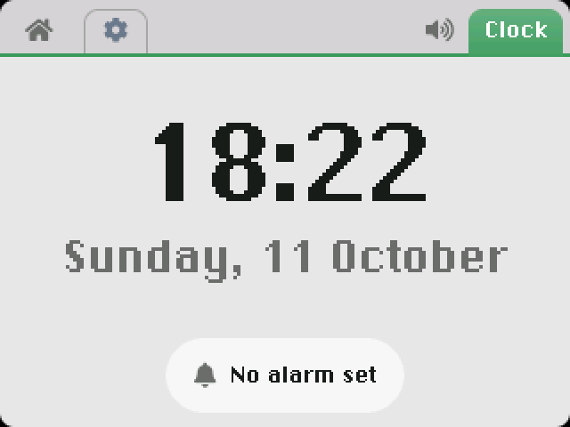
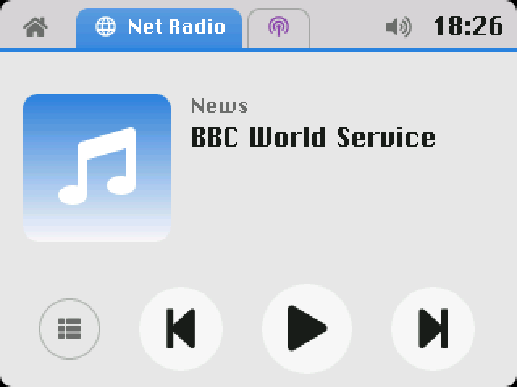
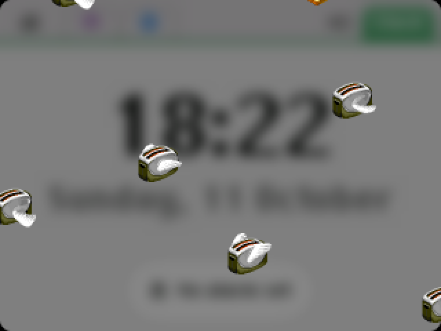

# Octopus OS

An operating system for the **nightstand clock radio you build yourself**
from a Raspberry Pi and a touchscreen. Flash a card and power on: it is
an appliance, not a desktop. It boots straight to a big clock, wakes you
with alarms, plays internet radio, podcasts and AirPlay, and goes dim and
warm at night.

<table>
  <tr>
    <td align="center"><br>The clock</td>
    <td align="center"><br>Internet radio</td>
  </tr>
  <tr>
    <td align="center"><br>Podcasts</td>
    <td align="center"><br>Flying Toasters</td>
  </tr>
</table>

It started as new firmware for the **Chumby One**, a 2009 Wi-Fi bedside
radio, and still runs on one (see [The Chumby One](#the-chumby-one)).
Octopus OS is an independent project, not affiliated with Chumby
Industries.

## What it does

- **A clock with alarms.** Big date, repeating alarms, snooze; a night
  mode with a dim, warm palette, on a schedule or by hand.
- **Internet radio and podcasts:** Icecast/Shoutcast, HLS, MP3 and AAC
  streams, resumable episodes, a seekable progress bar.
- **An AirPlay speaker** (shairport-sync), with remote control of the
  phone: play/pause, next/previous.
- **Tuning for small speakers:** a bass enhancer
  ([bankstown](https://github.com/chadmed/bankstown)) in three strengths,
  EQ presets, and your own EQ from a Room EQ Wizard export.
- **Flying Toasters,** After Dark's screen saver, over a live blur of the
  screen.
- **Settings,** by category: night mode, the screen saver, the time zone,
  the SSH server (off by default; turning it on makes a random root
  password, shown there), the sound.
- **Apps you can write and install:** bundles built with the SDK,
  installed from a USB stick or over the network. See
  [Writing apps](#writing-apps).

Under the hood: a Linux kernel, a small buildroot userland with systemd,
a Wayland compositor rendering on the Pi's GPU, apps running as an
unprivileged user, and over-the-air updates by rsync.

## What you need

| Part | What works | Notes |
|---|---|---|
| **Raspberry Pi** | Any 64-bit one: 3, 3B+, Zero 2 W, 4, 400, 5, 500, CM3/4/5 | Tested on a Pi 4. Wi-Fi is built in (or use Ethernet). |
| **Screen + touch** | An HDMI screen with a USB touch panel | The UI is 320x240, scaled up by a whole number, so any size works; a mouse works too. |
| **Speakers** | Through the Pi's first HDMI port | e.g. a screen with speakers, or an HDMI audio board with an amplifier. Other outputs need one line changed (below). |
| **A shell** | Anything that holds it all on a nightstand | A case or stand for the screen, room for the Pi and speakers, some airflow. |
| Power, storage | The Pi's official power supply; a microSD card | The image is about 320 MB. |

### The easy way: a RasPad 3

SunFounder's **RasPad 3** is all of the above in one: a tablet case around
a Raspberry Pi 4 with a 10.1" 1280x800 touchscreen (USB, an ILITEK
controller), speakers and an amplifier fed by HDMI, and a battery.
Octopus OS was built on one, so it works as it is: the touch comes
calibrated, and the sound goes through the speaker tuning to its
speakers. Stand it on the nightstand and you're done.

### Building your own

- **Screen:** an HDMI screen with a USB touch panel is the safe choice.
  Most are standard HID touch devices the kernel handles without any
  setup (the RasPad's is one). Drivers for the official Raspberry Pi DSI
  touchscreen and common I2C/SPI touch controllers (Goodix, FocalTech/EDT,
  ADS7846) are built too, but untested, and they need their `dtoverlay=`
  line in `config.txt` on the card. The picture is sharpest when the
  screen's height is a multiple of 240 (720, 960, 1080...): the rest is a
  black border. The UI has no brightness control unless the screen has a
  kernel backlight driver; night mode darkens it either way.
- **Speakers:** the sound goes to the first HDMI port's audio, through the
  bass and EQ chain. For the 3.5 mm jack (not on a Pi 5), a USB sound card
  or an I2S amplifier board (e.g. a MAX98357A), change the one match in
  `board/raspad/rootfs/etc/wireplumber/wireplumber.conf.d/50-raspad-speakers.conf`
  to that output's name (`wpctl status` lists them on the device), and
  for an I2S board add its `dtoverlay=` to `config.txt`. Small full-range
  drivers are what the bass enhancer is made for.
- **The shell:** a picture-frame or wooden box, a 3D-printed stand, or a
  mount for the screen. Leave the Pi some air (a Pi 4 or 5 wants a
  heatsink), and face the speakers towards you, not the wall.

## Getting started

You need Docker on a Linux PC. The build runs in a pinned Ubuntu 20.04
container.

```sh
git clone --recurse-submodules https://github.com/luuoaoa/octopus-os.git
cd octopus-os
bash docker-build.sh raspad
# -> output-raspad/images/sdcard.img
```

The first build takes a while (the toolchain and kernel are built from
source); later ones only redo what changed. Buildroot is a submodule,
pinned at release 2026.02.1: if you cloned without
`--recurse-submodules`, run `git submodule update --init`.

Write `sdcard.img` to a microSD card. Before the first boot, edit the
files on its FAT partition (any computer mounts it):

- **`network-config`:** your Wi-Fi.

  ```yaml
  version: 2
  wifis:
    wlan0:
      dhcp4: true
      access-points:
        "MySSID":
          password: "MyPassphrase"
  ```
- **`user-data`:** the hostname, the time zone (the clock syncs over NTP),
  and optionally SSH and a new root password.
- **`authorized_keys`:** SSH keys for root.
- **`eq.txt`** (optional): your own speaker EQ, as Room EQ Wizard exports
  it (*File > Export > Filter settings as text*); pick **Custom** in
  Settings > Sound.

They're applied at every boot, so edit and reboot to change them. To
build them into the image instead, put them in `customize-raspad/` at the
top of the tree (it's gitignored: it holds your Wi-Fi password).

SSH is off by default. Turn it on in **Settings > Network** (it makes a
random root password and shows it), or put `ssh: true` in `user-data` to
have it on from the first boot.

### Updating a running device

```sh
bash docker-build.sh raspad
bin/update-raspad.sh <device address>
```

This rsyncs what changed onto the running system, keeps your settings,
alarms and installed apps, and reboots. No reflashing.

## Writing apps

Apps are C programs on **liboctopus**: LVGL 9 plus Octopus's theme,
fonts, sound and system helpers.

- **[docs/sdk.md](docs/sdk.md):** the SDK. Build apps on any Linux PC with
  Docker, without buildroot, and see them in a simulator: Octopus OS's
  real compositor, shell and apps, running under QEMU as a window on your
  desktop. Package them as `.octopusapp` bundles, installed from a USB
  stick or with `octopus-app deploy`.
- **[docs/sdk-build.md](docs/sdk-build.md):** building the SDK yourself,
  with `sdk/make-sdk.sh`: for a Raspberry Pi by default, the Chumby One,
  or a board of your own.
- **[docs/sdk-tutorial.md](docs/sdk-tutorial.md):** a walk-through
  building One Song, an app that plays a song from the internet.
- **[docs/writing-octopus-apps.md](docs/writing-octopus-apps.md):** how the
  UI and sound fit together, and the traps.

## Working on the system

- **[board/raspad/README.md](board/raspad/README.md)** is the Raspberry Pi
  reference: which Pi, the display scaling, touch and mouse, the sound
  chain.
- The UI was designed for the Chumby One's 320x240 screen and slow CPU,
  which keeps it light on any Pi.
- Measure performance on the device: the simulator runs much faster.

## The Chumby One

Octopus OS began as a replacement firmware for the Chumby One (2009): a
Freescale i.MX23 (one ARM9 core at 454 MHz, no FPU), 64 MB of RAM, a
320x240 resistive touchscreen, an FM tuner and a snooze bar. On it,
everything but the stock bootloader is replaced: a mainline Linux 6.19
kernel (with new drivers for its audio codec, panel and power button), a
read-only root, and the same apps plus **FM radio with RDS**.

If you have one, building for it needs an image of its stock SD card
(the bootloader is reused):

```sh
board/falconwing/extract-stock.sh /path/to/stock-sdcard.img   # once
bash docker-build.sh falconwing-mainline
# -> output-falconwing-mainline/images/sdcard.img
bin/update-chumby.sh <its address>     # updating a running one
```

**[board/falconwing-mainline/README.md](board/falconwing-mainline/README.md)**
is its detailed reference: the boot chain, the kernel patches, FM, the
hardware watchdog, and trying builds without reflashing (`bin/chumby-try`).

## Repository

```
configs/raspad_defconfig                the Raspberry Pi image
configs/falconwing_mainline_defconfig   the Chumby One image
board/raspad/                           Pi board files and root overlay
board/falconwing-mainline/              Chumby One board files, kernel patches, root overlay
board/falconwing/                       the Chumby One stock-kernel image, the shared overlay
package/
  octopus-wm/        the Wayland compositor (wlroots)
  octopus-shell/     tab bar, Home menu, alarms, buttons, screen saver policy
  octopus-apps/      the system apps: clock, AirPlay, Settings, the stream
                     player, Flying Toasters (and FM on the Chumby One)
  octopus-bundled-apps/  builds apps/ as preinstalled app bundles
  liboctopus/        the app framework (LVGL 9 compiled in), the saver kit
  bankstown/         the bass enhancer (LV2)
  qn8005/            the Chumby One's FM tuner tool and RDS decoder
  wlroots-pixman/    wlroots, on the GPU (Pi) or in software (Chumby One)
apps/               Internet Radio, Podcasts: app bundles, built like anyone's
sdk/                octopus-app, the SDK's Docker images, examples
docs/               writing apps, the SDK, the tutorial
bin/                update-raspad.sh, update-chumby.sh, chumby-try
buildroot/          submodule
```
